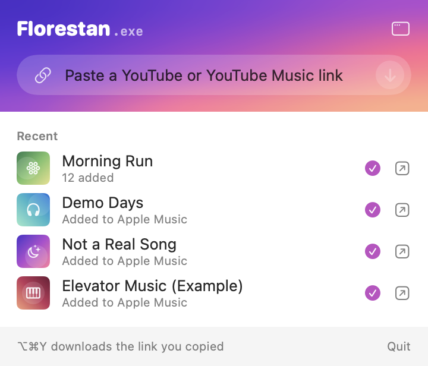
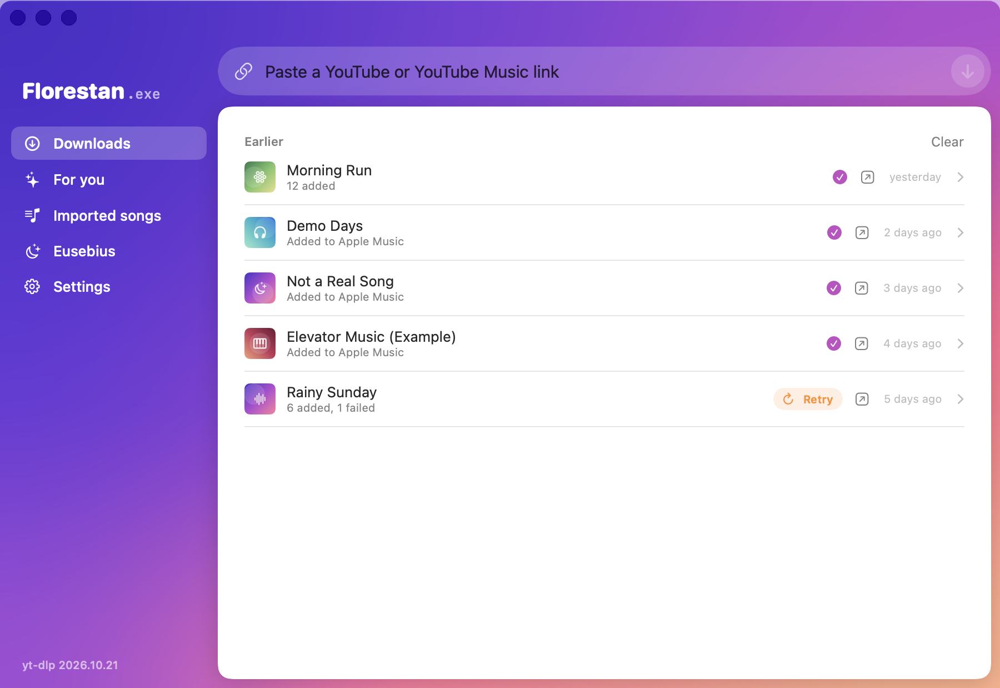
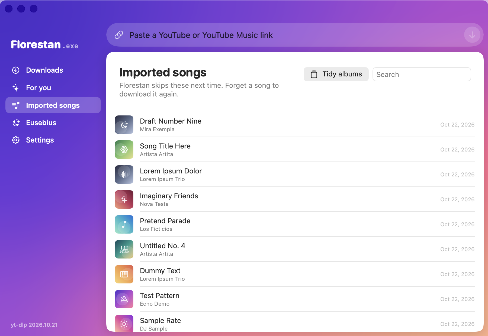
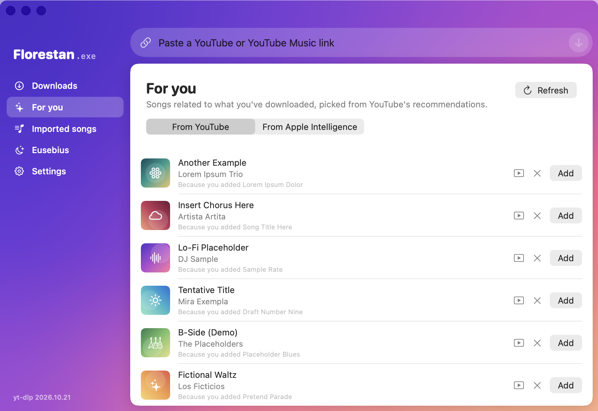
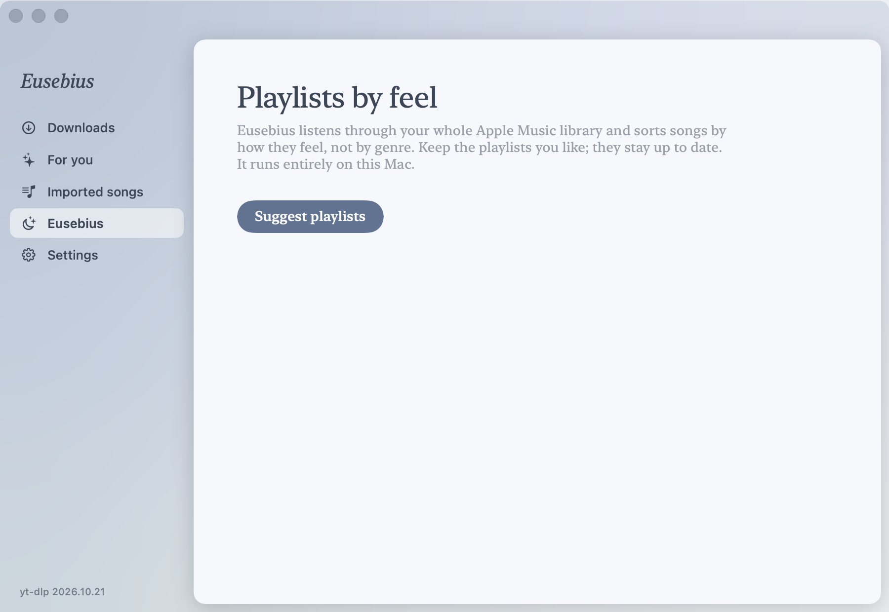
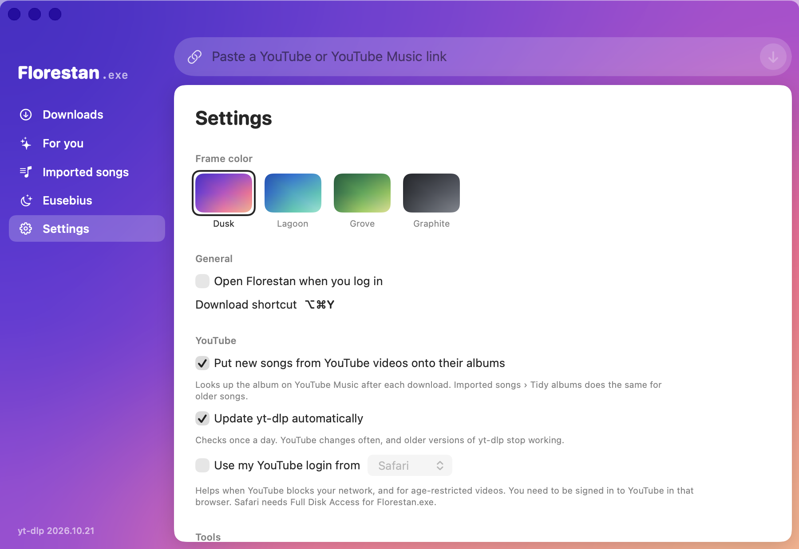

# Florestan.exe

**Version 1.0** · macOS 26 or later · Apple Silicon

A small Mac menu bar app: paste a YouTube or YouTube Music link, and the song (or the whole playlist) lands in
your Apple Music library, with a matching playlist. **Eusebius**, its calm other half, sorts your library into
mood playlists using Apple's on-device model, and **Tidy albums** keeps songs on the right album, in the right order,
with a matching square cover.

> [!IMPORTANT]
> **Florestan is not a tool for copyright infringement.** Only use it for content you own or have the rights to
> download: your own uploads, recordings you made, or music the rights holder has released for free download
> (for example under a Creative Commons licence). Downloading anything else may break YouTube's Terms of Service
> and copyright law where you live. If you like an artist's music, buy it or stream it so they get paid.
> You alone are responsible for what you download; the authors accept no liability for misuse.

<p align="center">
  
</p>



<table>
  <tr>
    <td></td>
    <td></td>
  </tr>
  <tr>
    <td align="center">Imported songs</td>
    <td align="center">For you</td>
  </tr>
  <tr>
    <td></td>
    <td></td>
  </tr>
  <tr>
    <td align="center">Eusebius</td>
    <td align="center">Settings</td>
  </tr>
</table>

<sub>Every artist, song and cover in these screenshots is made up.</sub>

## What you need

- A Mac with **Apple Silicon** (M1 or newer) running **macOS 26** or later.
- The Music app. No Apple Music subscription is needed.
- Optional: Apple Intelligence turned on, for Eusebius mood playlists and offline song ideas.

Nothing else: Florestan carries its own copies of yt-dlp, ffmpeg and deno, and keeps yt-dlp up to date.

## Install

1. Download **Florestan.exe.dmg** from the [latest release](https://github.com/ingridstevens/florestan/releases/latest).
2. Open it and drag **Florestan.exe** onto the **Applications** folder.
3. Eject the disk image.

### Opening it the first time

Florestan isn't from the App Store and isn't notarized by Apple (that needs a paid developer account), so macOS
blocks it the first time with a message that it "can't check it for malicious software". To open it anyway:

1. Double-click **Florestan.exe** in Applications. When the warning appears, click **Done** (not *Move to Trash*).
2. Open **System Settings › Privacy & Security** and scroll down to the **Security** section.
   You'll see *"Florestan.exe" was blocked to protect your Mac*. Click **Open Anyway**.
3. Confirm with your password or Touch ID, then click **Open Anyway** once more.

You only do this once. Florestan then lives in the menu bar as a **♪** icon (it has no Dock icon).

<details>
<summary>"Open Anyway" doesn't appear?</summary>

The button only shows for about an hour after the blocked attempt, so double-click the app again and go straight back
to Privacy & Security. If it still won't open, you can remove the download quarantine in Terminal instead. Only do
this for apps you trust:

```sh
xattr -dr com.apple.quarantine /Applications/Florestan.exe.app
```
</details>

### Permissions it asks for

- **Control Music**: asked on the first import. Click **OK**; it's how songs get into your library. If you clicked
  *Don't Allow*, turn it on in **System Settings › Privacy & Security › Automation › Florestan.exe › Music**.
- **Notifications**: optional, to tell you when a download finishes.

## Use

- Click the **♪** menu bar icon and paste a link. A YouTube link already on your clipboard is filled in for you.
- Or copy a link anywhere and press **⌥⌘Y**.
- Or drag a link onto the menu bar panel or the window.
- The window (open it from the menu bar panel) has your download history, imported songs, recommendations,
  Eusebius and settings.

A link to a single video imports one song. A link to a playlist or a YouTube Music album imports all of it and
creates a playlist of the same name, in the same order.

### Tidy albums

Songs from plain YouTube videos arrive without an album. **Tidy albums** (in *Imported songs*) looks them up on
YouTube Music, puts them on their album in album order, and makes each album's songs agree on album artist, year and
a square cover, so Apple Music shows every album once. It also points out duplicates. With *Put new songs from YouTube
videos onto their albums* on in Settings, new downloads are tidied automatically.

### Getting the music onto your iPhone (no subscription needed)

1. Connect the iPhone to the Mac with a cable, open **Finder**, and click the iPhone in the sidebar.
2. On the **Music** tab, tick **Sync music onto iPhone**, choose your whole library or selected albums and
   playlists, and click **Apply**.
3. To sync over Wi-Fi from then on, tick **Show this iPhone when on Wi-Fi** on the **General** tab.

Click **Sync** again after downloading new songs. If the Music tab is greyed out, turn off
**Settings › Apps › Music › Sync Library** on the iPhone first.

### Troubleshooting

- **"Bot check" errors**: YouTube is blocking your network. VPNs and data-center IP addresses often are. Turn off
  the VPN or switch networks, or turn on *Use my YouTube login* in Settings.
- **An album shows up more than once in Music**: run **Tidy albums**. Apple Music splits an album when its songs
  differ in album artist (even invisibly, in how an accent is encoded) or year.
- **Eusebius is unavailable**: turn on Apple Intelligence in **System Settings › Apple Intelligence & Siri**.

## Build it yourself

Needs only the Xcode Command Line Tools (`xcode-select --install`):

```sh
./scripts/fetch-tools.sh      # once: downloads yt-dlp, deno and ffmpeg to carry inside the app
./scripts/setup-signing.sh    # once: a local signing certificate, so permissions survive rebuilds
./scripts/build-app.sh        # builds and installs ~/Applications/Florestan.exe.app
./scripts/test.sh             # core logic tests
./scripts/make-dmg.sh         # builds build/Florestan.exe.dmg to share
./scripts/make-screenshots.sh # retakes docs/screenshots from made-up songs in docs/demo, not your own
```

See [`CONTEXT.md`](CONTEXT.md) for the vocabulary used in the code.

## Third-party software

The app bundles [yt-dlp](https://github.com/yt-dlp/yt-dlp) (Unlicense), [deno](https://github.com/denoland/deno)
(MIT) and [FFmpeg](https://ffmpeg.org) (GPL v3). See [`THIRD-PARTY-NOTICES.md`](THIRD-PARTY-NOTICES.md).

## License

Florestan's own code is public domain (the Unlicense, see [`LICENSE`](LICENSE)): use, fork and change it freely, no
credit needed. The bundled tools keep their own licences.
