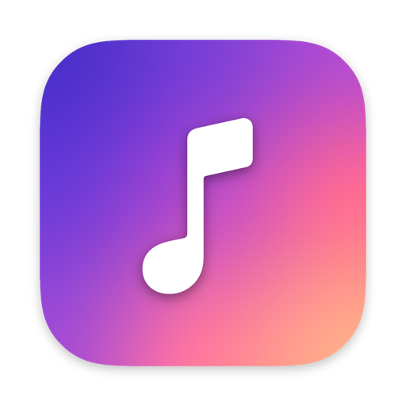
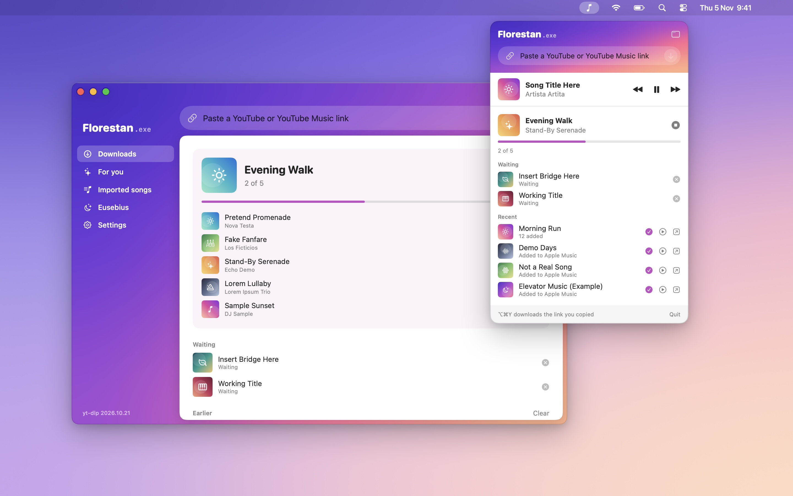
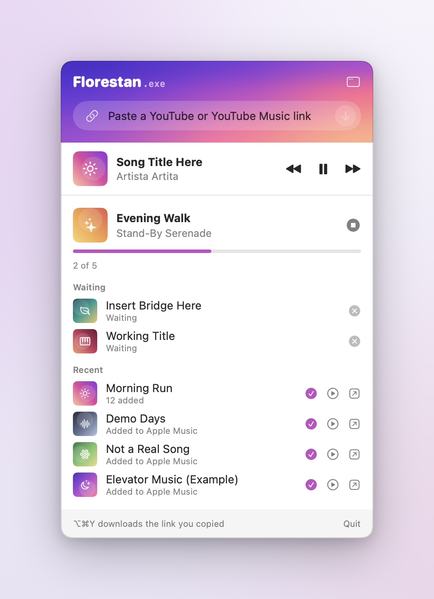
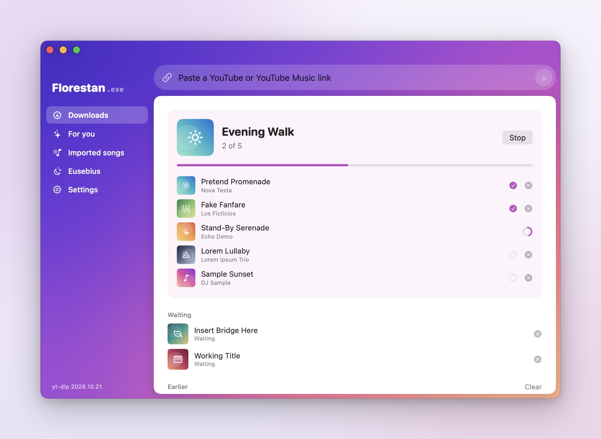
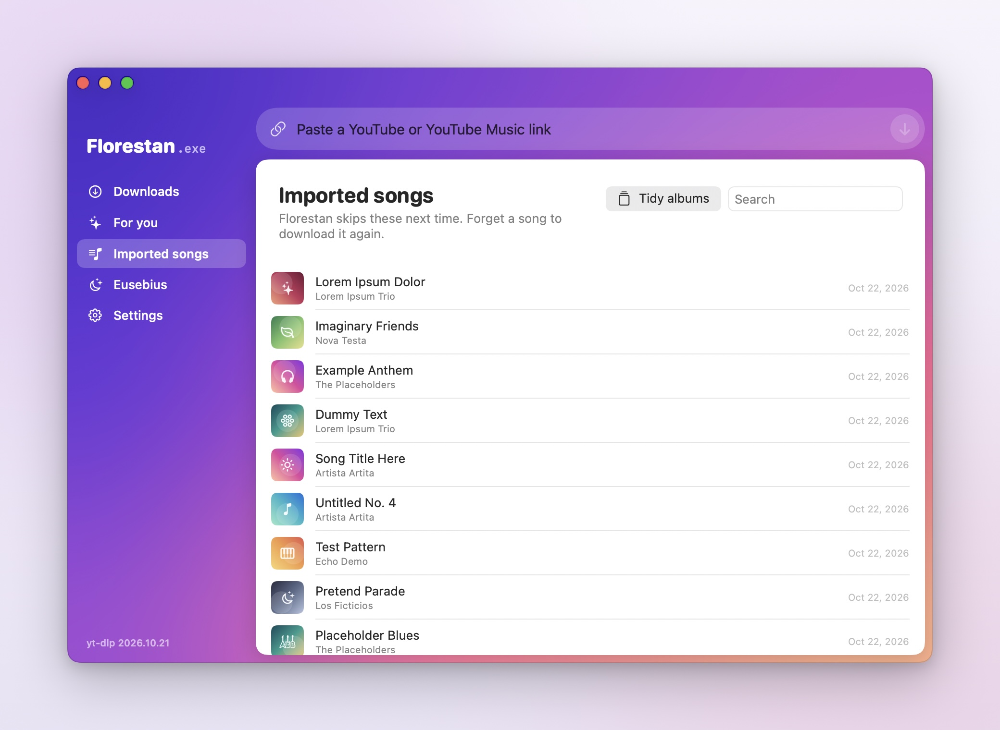
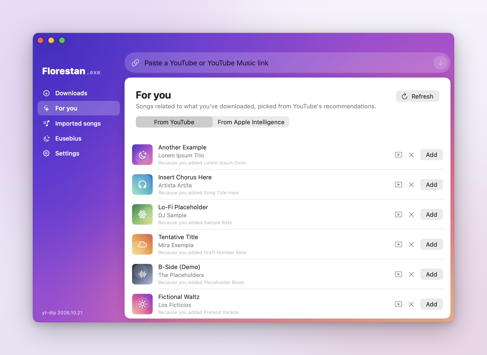
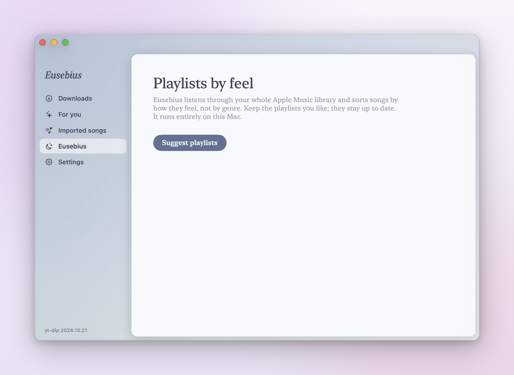
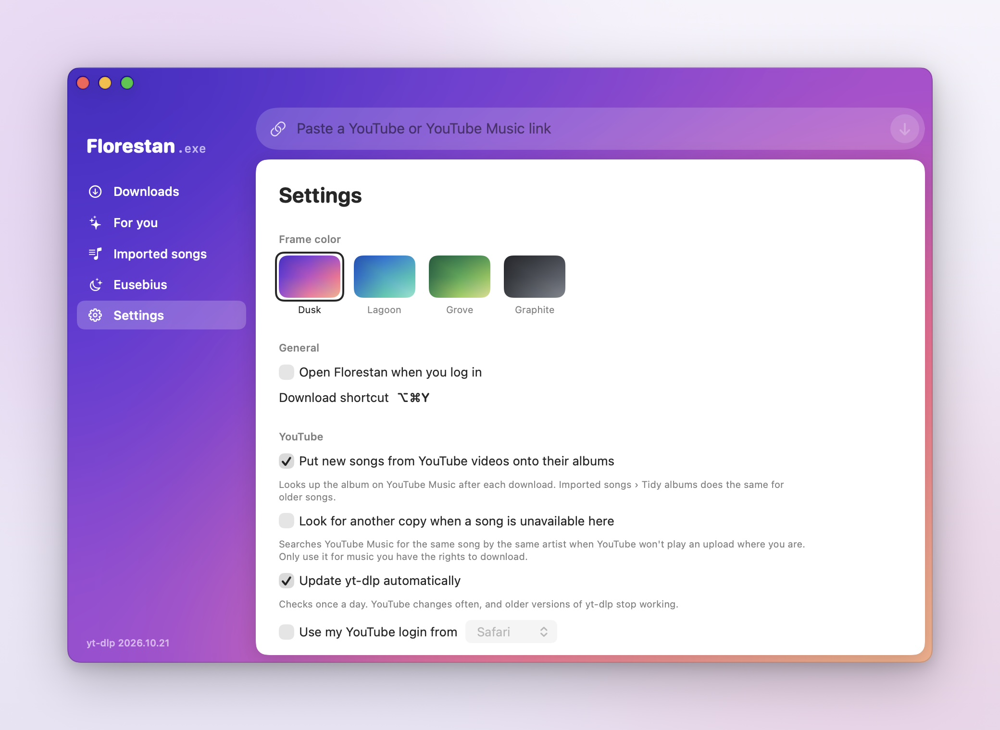

<p align="center">
  
</p>

<h1 align="center">Florestan.exe</h1>

<p align="center">
  <b>Paste a YouTube link. Get the song in Apple Music.</b><br>
  A small Mac menu bar app for songs and whole playlists, with a player, mood playlists and tidy albums.
</p>

<p align="center">
  <a href="https://github.com/ingridstevens/florestan/releases/latest"></a>
  
  
  <a href="LICENSE"></a>
</p>

<p align="center">
  <a href="https://github.com/ingridstevens/florestan/releases/latest"><b>⬇ Download Florestan.exe for Mac</b></a>
  &nbsp;·&nbsp; Version 0.0.2 &nbsp;·&nbsp; <a href="#install">How to install</a>
</p>

<p align="center">
  
</p>

> [!IMPORTANT]
> **Florestan is not a tool for copyright infringement.** Only use it for content you own or have the rights to
> download: your own uploads, recordings you made, or music the rights holder has released for free download
> (for example under a Creative Commons licence). Downloading anything else may break YouTube's Terms of Service
> and copyright law where you live. If you like an artist's music, buy it or stream it so they get paid.
> You alone are responsible for what you download; the authors accept no liability for misuse.

## Features

<table>
  <tr>
    <td width="50%" valign="top">
      
    </td>
    <td width="50%" valign="top">
      <h3>Lives in your menu bar</h3>
      <p>Paste a link, press <b>⌥⌘Y</b> with one copied, or drag it onto the panel. Florestan shows what's downloading and what's waiting, and won't fetch a song you already have.</p>
      <h3>Plays your music</h3>
      <p>See what Music is playing and skip or pause from the panel. Play buttons on your downloads start a song, or a whole playlist from the top. Music does the playing, so your media keys and AirPlay keep working.</p>
      <h3>Whole playlists</h3>
      <p>A playlist or YouTube Music album arrives as a playlist of the same name, in the same order.</p>
    </td>
  </tr>
</table>

### Downloads

Every song and playlist, with progress for each track. A song that failed has a Retry button. Links still waiting
when you quit pick up where they left off next time.



<table>
  <tr>
    <td width="50%" valign="top">
      
      <h3>Imported songs</h3>
      <p>Everything Florestan added, with search. <b>Tidy albums</b> puts songs on their album, in album order, with one square cover.</p>
    </td>
    <td width="50%" valign="top">
      
      <h3>For you</h3>
      <p>Songs related to what you've downloaded, from YouTube or from Apple Intelligence on your Mac.</p>
    </td>
  </tr>
  <tr>
    <td width="50%" valign="top">
      
      <h3>Eusebius</h3>
      <p>Florestan's calm other half sorts your whole library into mood playlists, entirely on your Mac.</p>
    </td>
    <td width="50%" valign="top">
      
      <h3>Settings</h3>
      <p>Four frame colours, open at login, and yt-dlp kept up to date in the background.</p>
    </td>
  </tr>
</table>

<sub>Every artist, song and cover in these screenshots is made up.</sub>

## What you need

- A Mac with **Apple Silicon** (M1 or newer) running **macOS 26** or later.
- The Music app. No Apple Music subscription is needed.
- Optional: Apple Intelligence turned on, for Eusebius mood playlists and offline song ideas.

Nothing else: Florestan carries its own copies of yt-dlp, ffmpeg and deno, and keeps yt-dlp up to date.

## Install

1. Download **Florestan.exe.dmg** from the [latest release](https://github.com/ingridstevens/florestan/releases/latest).
2. Open it and drag **Florestan.exe** onto the **Applications** folder.
3. Eject the disk image.

### Opening it the first time

Florestan isn't from the App Store and isn't notarized by Apple (that needs a paid developer account), so macOS
blocks it the first time with a message that it "can't check it for malicious software". To open it anyway:

1. Double-click **Florestan.exe** in Applications. When the warning appears, click **Done** (not *Move to Trash*).
2. Open **System Settings › Privacy & Security** and scroll down to the **Security** section.
   You'll see *"Florestan.exe" was blocked to protect your Mac*. Click **Open Anyway**.
3. Confirm with your password or Touch ID, then click **Open Anyway** once more.

You only do this once. Florestan then lives in the menu bar as a **♪** icon (it has no Dock icon).

<details>
<summary>"Open Anyway" doesn't appear?</summary>

The button only shows for about an hour after the blocked attempt, so double-click the app again and go straight back
to Privacy & Security. If it still won't open, you can remove the download quarantine in Terminal instead. Only do
this for apps you trust:

```sh
xattr -dr com.apple.quarantine /Applications/Florestan.exe.app
```
</details>

### Permissions it asks for

- **Control Music**: asked on the first import. Click **OK**; it's how songs get into your library. If you clicked
  *Don't Allow*, turn it on in **System Settings › Privacy & Security › Automation › Florestan.exe › Music**.
- **Notifications**: optional, to tell you when a download finishes.

## Use

Click the **♪** in the menu bar and paste a link, press **⌥⌘Y** with a link copied, or drag one onto the panel.
A single video becomes one song; a playlist or YouTube Music album becomes a playlist of the same name, in the
same order. Open the window from the panel for everything else.

### Tidy albums

Songs from plain YouTube videos arrive without an album. **Tidy albums** (in *Imported songs*) looks them up on
YouTube Music, puts them on their album in album order, and makes each album's songs agree on album artist, year and
a square cover, so Apple Music shows every album once. It also points out duplicates. With *Put new songs from YouTube
videos onto their albums* on in Settings, new downloads are tidied automatically.

<details>
<summary><b>Getting the music onto your iPhone</b> (no subscription needed)</summary>

1. Connect the iPhone to the Mac with a cable, open **Finder**, and click the iPhone in the sidebar.
2. On the **Music** tab, tick **Sync music onto iPhone**, choose your whole library or selected albums and
   playlists, and click **Apply**.
3. To sync over Wi-Fi from then on, tick **Show this iPhone when on Wi-Fi** on the **General** tab.

Click **Sync** again after downloading new songs. If the Music tab is greyed out, turn off
**Settings › Apps › Music › Sync Library** on the iPhone first.
</details>

<details>
<summary><b>Making the Music app quieter</b> (if you don't subscribe to Apple Music)</summary>

Music shows Apple Music and the iTunes Store even when you only play your own songs. To hide them, open Music,
choose **Music › Settings…**, click **General**, and under **Show** untick **Apple Music** and **iTunes Store**.
Their sections disappear from the sidebar, leaving more room for your library and the playlists Florestan makes.
</details>

<details>
<summary><b>Troubleshooting</b></summary>

- **"Bot check" errors**: YouTube is blocking your network. VPNs and data-center IP addresses often are. Turn off
  the VPN or switch networks, or turn on *Use my YouTube login* in Settings.
- **"Video unavailable here"**: YouTube won't play that upload where you are. Turn on *Look for another copy* in
  Settings to try other uploads of the same song by the same artist, for music you have the rights to download.
- **An album shows up more than once in Music**: run **Tidy albums**. Apple Music splits an album when its songs
  differ in album artist (even invisibly, in how an accent is encoded) or year.
- **Eusebius is unavailable**: turn on Apple Intelligence in **System Settings › Apple Intelligence & Siri** (on
  macOS 27 the pane is called **Siri**).
</details>

## Updating

Florestan tells you in its menu bar panel when a new version is out. Download the new **Florestan.exe.dmg** from
the [latest release](https://github.com/ingridstevens/florestan/releases/latest) and drag it onto **Applications**,
replacing the old copy. Your songs, history and settings stay. macOS may
block it once more with the "Open Anyway" step, and ask again for permission to control Music: click **OK**.

## Uninstalling

1. Click **Quit** in Florestan's menu bar panel.
2. Move **Florestan.exe** from Applications to the Trash.
3. To remove its data too, delete `~/Library/Application Support/Florestan` (history, the record of imported songs,
   and its copies of yt-dlp, ffmpeg and deno) and `~/Music/Florestan` (downloads that never made it into Music).

The songs and playlists it added stay in Apple Music.

## Privacy

Florestan has no account, no analytics and no server of its own. It connects to:

- **YouTube and YouTube Music**, to read links, download audio, show thumbnails and find suggestions and albums;
- **GitHub**, at launch and then once a day, to see whether new versions of yt-dlp or Florestan are out.

It reads your browser's YouTube login only if you turn on *Use my YouTube login*, and only to pass it to yt-dlp.
Eusebius and the Apple Intelligence suggestions run entirely on your Mac.

## Known limitations

- **Apple Silicon only**, and macOS 26 or later.
- **Not notarized** by Apple, so macOS asks you to approve it the first time and after each update (see above).
- **A single song plays on its own.** Music's scripting can't start a song and carry on to the next, so Next does
  nothing after a song you played from Florestan. Playlists play through.
- **The player needs Music.** Florestan is a remote control for the Music app; it doesn't play audio itself.

## Why Florestan?

The name comes from the composer Robert Schumann. He gave the two sides of his personality names of their own:
**Florestan**, fiery and impulsive, and **Eusebius**, dreamy and reflective. In the 1830s he signed reviews in his
music journal, the *Neue Zeitschrift für Musik*, with their names. He wrote music for them too. In
*Davidsbündlertänze* (Op. 6) he marked each piece F. or E. for the side that "wrote" it, and *Carnaval* (Op. 9)
has a movement called "Eusebius" followed by one called "Florestan".

The app splits the same way. Florestan is the busy half that goes out and fetches music. Eusebius is the calm half
that listens through your library and sorts it by mood.

And the .exe? A Windows program ending on a Mac app. It's a joke.

## Build it yourself

Needs only the Xcode Command Line Tools (`xcode-select --install`):

```sh
./scripts/fetch-tools.sh      # once: downloads yt-dlp, deno and ffmpeg to carry inside the app
./scripts/setup-signing.sh    # once: a local signing certificate, so permissions survive rebuilds
./scripts/build-app.sh        # builds and installs ~/Applications/Florestan.exe.app
./scripts/test.sh             # core logic tests
./scripts/make-dmg.sh         # builds build/Florestan.exe.dmg to share
./scripts/make-screenshots.sh # retakes docs/screenshots from made-up songs in docs/demo, not your own
```

See [`CONTEXT.md`](CONTEXT.md) for the vocabulary used in the code.

## Third-party software

The app bundles [yt-dlp](https://github.com/yt-dlp/yt-dlp) (Unlicense), [deno](https://github.com/denoland/deno)
(MIT) and [FFmpeg](https://ffmpeg.org) (GPL v3). See [`THIRD-PARTY-NOTICES.md`](THIRD-PARTY-NOTICES.md).

## License

Florestan's own code is public domain (the Unlicense, see [`LICENSE`](LICENSE)): use, fork and change it freely, no
credit needed. The bundled tools keep their own licences.
